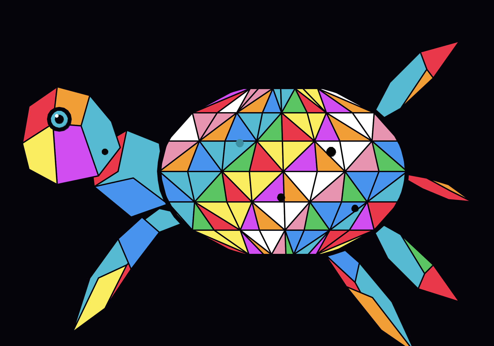

# Creative Geometric Sea Turtle — v0.3

## 1. What it does

Creative Geometric Sea Turtle is a Python artwork that combines Turtle and Pillow to create a colourful geometric sea turtle illustration on a black background.

## 2. Libraries used

### Turtle
- Draws the sea turtle's head, eye, shell, flippers and tail.
- Creates colourful geometric polygons.
- Displays the final artwork in a graphics window.

### Pillow
- Creates the black background image.
- Saves the background as a GIF file.
- Supplies the background image that Turtle loads.

## 3. Requirements

- Python 3
- Pillow library
- Turtle module (included with Python)

Install Pillow using:

```bash
python -m pip install Pillow
```

## 4. How to run

From the root of the project, activate the virtual environment:

```bash
source .venv/bin/activate
```

Run the program:

```bash
python v0.3-creative-turtle/draw_turtle.py
```

## 5. Expected output

The program opens a graphics window displaying:
- A black background.
- A colourful geometric sea turtle.
- A patterned shell.
- A colourful head and eye.
- Four geometric flippers.
- A pointed tail.

The program also creates `background.gif` automatically in this folder.



## 6. Current limitations

- The artwork is made from manually defined geometric shapes.
- It is an artistic approximation, not an exact copy of the reference image.
- The turtle is a static illustration and does not swim or animate.
- The drawing is displayed in a Turtle graphics window.
- The background GIF is generated automatically each time the program runs.

## What I learned

- How to combine two Python libraries in one project.
- How to create images using Pillow.
- How to draw polygons using Turtle.
- How to use functions and loops to organise drawing code.
- How to use coordinates to construct geometric artwork.
- How to run and test a combined Python program.
